# Machine Learning-Based Intrusion Detection and Prevention Across Wireless Network Layers

[](https://fastapi.tiangolo.com)
[](https://react.dev)
[](https://vitejs.dev)
[](https://pytorch.org)
[](https://www.nsnam.org)
[](https://tailwindcss.com)
[](https://www.sqlite.org)
[](https://alembic.sqlalchemy.org)
[](https://www.python.org)

An end-to-end wireless network security and intrusion mitigation framework combining **Discrete-Event Network Simulation (NS-3.41)**, **Cross-Layer Telemetry Extraction**, **Classical Machine Learning (Random Forest active inference, SVM & MLP baselines)**, **Deep Sequential Trust Modeling (PyTorch TrustLSTM)**, **Simulated In-Process Federated Learning (FedAvg)**, **Two-Tier Network Isolation & Geographic Request Zone Routing**, and **Decoupled 5-Stage SQLite WAL Persistence with Non-Blocking Checkpoints**.

---

## Table of Contents

- [1. Project Overview](#1-project-overview)
- [2. Problem Statement and Objectives](#2-problem-statement-and-objectives)
- [3. Key Features](#3-key-features)
- [4. Technology Stack & Exact Verified Versions](#4-technology-stack--exact-verified-versions)
- [5. System Architecture and Workflow](#5-system-architecture-and-workflow)
- [6. Project Folder Structure](#6-project-folder-structure)
- [7. SQLite Database Architecture & Schema Specification](#7-sqlite-database-architecture--schema-specification)
- [8. Five-Stage Database Persistence Pipeline & Ledger](#8-five-stage-database-persistence-pipeline--ledger)
- [9. Automatic SQLite WAL Checkpoint Management](#9-automatic-sqlite-wal-checkpoint-management)
- [10. Machine Learning & Sequential Trust Subsystem](#10-machine-learning--sequential-trust-subsystem)
  - [Classical Machine Learning Models & Active Inference](#classical-machine-learning-models--active-inference)
  - [Deep Sequential LSTM Trust Evaluation](#deep-sequential-lstm-trust-evaluation)
  - [Federated Learning (Simulated In-Process FedAvg)](#federated-learning-simulated-in-process-fedavg)
- [11. Network Simulation & Intrusion Prevention (NS-3)](#11-network-simulation--intrusion-prevention-ns-3)
  - [Attack Mechanism](#attack-mechanism)
  - [Dual-Tier Mitigation: Interface Isolation & AODV Blacklisting](#dual-tier-mitigation-interface-isolation--aodv-blacklisting)
  - [Geographic Request Zone (AODV LAR Enhancement)](#geographic-request-zone-aodv-lar-enhancement)
  - [Two-Pass Trust Rerouting Workflow](#two-pass-trust-rerouting-workflow)
- [12. Verified Simulation Configurations & Experimental Evidence](#12-verified-simulation-configurations--experimental-evidence)
  - [Production Database Simulation Audit (9 Genuine Runs)](#production-database-simulation-audit-9-genuine-runs)
  - [Scope of Verification Across Node Counts](#scope-of-verification-across-node-counts)
- [13. Prerequisites and System Requirements](#13-prerequisites-and-system-requirements)
- [14. Installation and Setup](#14-installation-and-setup)
  - [Backend Setup](#backend-setup)
  - [Frontend Setup](#frontend-setup)
  - [WSL2 / NS-3 Configuration](#wsl2--ns-3-configuration)
- [15. Environment Variables and Configuration](#15-environment-variables-and-configuration)
- [16. How to Run the Project Locally](#16-how-to-run-the-project-locally)
- [17. Complete FastAPI Endpoint Reference (23 Endpoints)](#17-complete-fastapi-endpoint-reference-23-endpoints)
- [18. Frontend Dashboard Walkthrough](#18-frontend-dashboard-walkthrough)
- [19. Verification, Testing & QA Matrix](#19-verification-testing--qa-matrix)
- [20. Known Project Limitations & Technical Boundaries](#20-known-project-limitations--technical-boundaries)
- [21. Future Enhancements](#21-future-enhancements)
- [22. Authors and Credits](#22-authors-and-credits)

---

## 1. Project Overview

Mobile Ad-hoc Networks (MANETs) are autonomous, self-configuring wireless networks of mobile nodes operating without static infrastructure, fixed base stations, or centralized gateways. Intermediate nodes collaboratively route and forward packets on behalf of their peers. This decentralized and cooperative topology makes MANETs highly vulnerable to routing-layer insider attacks—most notably **Black Hole** and **Gray Hole** packet-dropping attacks—where compromised nodes exploit trust in the Ad-hoc On-Demand Distance Vector (AODV) routing protocol to attract traffic and discard packets.

This project delivers a multi-tiered intrusion detection, trust modeling, and automated mitigation platform:

1. **Discrete-Event Simulation (NS-3.41)**: Models mobile wireless ad-hoc environments in Ubuntu WSL2 using IEEE 802.11b Wi-Fi, Random Waypoint mobility, AODV routing, FlowMonitor telemetry, and radio energy depletion.
2. **Classical Machine Learning Anomaly Detection**: Extracts cross-layer telemetry (packet flows, control overhead frequencies) and classifies node behaviors using RFECV-selected features (`rx`, `control_message_frequency`). **Random Forest** serves as the active production inference model, supported by trained **SVM** and **MLP** baselines.
3. **Sequential Deep Trust Modeling (`TrustLSTM`)**: A PyTorch recurrent neural network that tracks 5-step sliding sequences of forwarding rates and ratios (`rx_rate`, `fw_rate`, `drop_rate`, `fw_ratio`) to output continuous trust scores ($[0.0, 1.0]$), smoothing out temporary transmission drops and isolating nodes whose trust falls below $0.50$.
4. **Dual-Tier Network Mitigation**: Executes automated closed-loop remediation:
   - **Simulated IPv4 Interface Isolation**: Disables Interface 1 (the ad-hoc wireless interface) within the simulated NS-3 IPv4 network stack (`ipv4->SetDown(1)`).
   - **AODV Protocol Blacklisting**: Injects dynamic peer blacklisting into the AODV routing protocol kernel (`aodvDirect->BlacklistNode()`).
   - **Geographic Request Zone**: Enhances AODV route discovery using LAR principles (`ApplyLARFilter`) to restrict RREQ dissemination to a spatial bounding corridor between source and destination.
5. **Decoupled 5-Stage Relational Persistence**: Records all simulation runs, flow metrics, energy consumption, ML predictions, trust scores, recovered routing paths, and prevention events into an 11-table SQLite database with Write-Ahead Logging (WAL) and automatic passive checkpointing.
6. **Simulated In-Process Federated Learning**: Implements 5 rounds of Federated Averaging (`FedAvg`) in Python to demonstrate decentralized parameter aggregation across partitioned client subsets without centralizing raw traffic logs.
7. **Interactive React 19 Dashboard**: A responsive, 7-page operations console providing real-time simulation launching, dynamic 2D topology rendering, ML confusion matrices, top-aligned trust evaluation cards, hop-by-hop route visualization, and exportable prevention audit logs.

---

## 2. Problem Statement and Objectives

### Problem Statement
In MANETs, routing protocols such as AODV rely entirely on mutual peer trust. When a malicious insider node launches a Black Hole attack:
- It intercepts Route Request (RREQ) packets broadcast by a source node.
- It immediately generates a spoofed Route Reply (RREP) with a fabricated destination sequence number (`65535`) and minimum hop count (`1`), claiming the freshest and shortest path.
- The source directs unicast data traffic through this attacker, which then silently drops all received data packets, collapsing network Packet Delivery Ratio (PDR) to 0%.

Traditional perimeter firewalls cannot operate in infrastructureless MANETs, while static threshold rules trigger frequent false positives during natural mobility-induced link breakages.

### Core Objectives
- **Cross-Layer Behavioral Classification**: Detect malicious packet-dropping behaviors using verified cross-layer telemetry (received counts, AODV control overhead, packet drop ratios) without relying on unverified hardware PHY/MAC collision counters.
- **Dynamic Trust Evaluation**: Compute continuous temporal trust scores over sliding temporal windows ($SEQ\_LENGTH = 5$) to tolerate transient packet drops while swiftly isolating persistent attackers.
- **Closed-Loop Simulated Remediation**: Trigger dynamic two-pass NS-3 simulations where Pass 1 detects attacks and Pass 2 enforces IPv4 interface shutdown and AODV kernel blacklisting to reconstruct safe multi-hop paths.
- **Geographic Request Zone Containment**: Confine route discovery to a geographic bounding box between communication endpoints, preventing route hijacking outside safe operational corridors.
- **Transactional & Checkpointed Persistence**: Persist comprehensive simulation history across 5 decoupled database ingestion stages in SQLite WAL mode, guaranteeing zero manual checkpoint intervention.
- **Transparent Operational Visibility**: Deliver an interactive full-stack web UI for parameter configuration, topology rendering, metrics comparison, and forensic audit tracing.

---

## 3. Key Features

- **Automated Two-Pass Simulation Orchestrator**:
  - **Pass 1 (Attack Phase)**: Runs NS-3 with attacker nodes enabled; captures FlowMonitor XML, ASCII routing traces (`.tr`), per-node behavior CSVs, and energy logs.
  - **Pass 2 (Mitigation Phase)**: Reads dynamically generated `lstm_pred.csv` trust scores; invokes `ScheduleBlacklist()` at predicted timestamps to disable attacker IPv4 interfaces and blacklist IPs in AODV; parses recovered routing paths from ASCII traces.
- **Cross-Layer Telemetry Extraction**:
  - Synthesizes application-layer QoS (PDR, throughput, delay), network-layer control message frequency, transport-layer drops, and physical-layer battery depletion.
- **Classical ML & Active Inference Engine**:
  - **Random Forest**: Active production model in `app/ml/predict.py` (100.0% test accuracy on baseline datasets).
  - **SVM & MLP**: Trained and verified comparative baseline models (90.0% accuracy).
  - **XGBoost & CatBoost**: Preserved offline baseline artifacts.
  - **Feature Selection**: RFECV-selected optimal feature pair: `rx` and `control_message_frequency`.
- **Sequential Trust Modeling (`TrustLSTM`)**:
  - PyTorch recurrent neural network evaluating 5-step behavioral sequences (`rx_rate`, `fw_rate`, `drop_rate`, `fw_ratio`).
  - Evaluates dynamic trust $\text{TrustScore} = 1.0 - \sigma(\text{logit})$; flags nodes falling below $0.50$.
- **Simulated In-Process Federated Learning (FedAvg)**:
  - 3-client simulated ad-hoc clustering with local training (3 epochs, Adam) and server weight aggregation over 5 global rounds.
- **Dual-Tier Mitigation Mechanism**:
  - **Interface Isolation**: Disables Interface 1 in the simulated NS-3 IPv4 stack (`ipv4->SetDown(1)`).
  - **Routing Protocol Blacklisting**: Disables route replies and packet relays via `aodvDirect->BlacklistNode()`.
- **AODV Geographic Request Zone (`ApplyLARFilter`)**:
  - Implements a spatial bounding box between source and destination with a margin of $0.5 \times \text{simArea}$, filtering RREQs from nodes outside the corridor.
- **Idempotent 5-Stage SQLite Persistence**:
  - Fully transactional ingestion across 10 application tables with SHA-256 artifact verification and non-blocking `safe_wal_checkpoint(PASSIVE)`.
- **Modern Full-Stack Dashboard**:
  - React 19 + Tailwind CSS v4 interface featuring 7 dedicated pages, top-aligned trust evaluation cards (`self-start`), and live status polling.

---

## 4. Technology Stack & Exact Verified Versions

### Backend & Machine Learning
| Technology | Verified Version | Purpose & Implementation Details |
| :--- | :--- | :--- |
| **Python** | `3.14.0` / `3.10+` | Core backend runtime environment |
| **FastAPI** | `0.115.0+` | Asynchronous REST API framework (23 active endpoints) |
| **Uvicorn** | `0.30.0+` | High-performance ASGI production server |
| **SQLAlchemy** | `2.0.36+` | Declarative ORM mapping and connection pool management |
| **Alembic** | `1.13.0+` | Database schema migrations (current revision: `f7a2d3e4b5c6`) |
| **SQLite** | `3.50.4` | Embedded relational database engine (WAL Mode, `wal_autocheckpoint=256`) |
| **PyTorch** | `2.14.0+` | Deep learning engine for `TrustLSTM` sequence modeling and FL |
| **Scikit-Learn** | `1.9.1` | Classical ML pipelines, `StandardScaler`, and RFECV selection |
| **Pandas / NumPy** | `2.2.0+` / `1.26.0+` | Data manipulation, matrix math, and telemetry parsing |
| **Joblib** | `1.4.0+` | Model serialization (`RandomForest.pkl`, `scaler.pkl`) |

### Network Simulation Subsystem
| Technology | Verified Version | Purpose & Implementation Details |
| :--- | :--- | :--- |
| **NS-3** | `ns-allinone-3.41` | Discrete-event wireless simulation executed inside WSL2 Ubuntu |
| **C++ Standard** | `C++17` | Compilation target for `basic_manet_simulation.cc` |
| **Wi-Fi Standard** | IEEE 802.11b | `ns3::AdhocWifiMac`, `ns3::YansWifiPhy`, `DsssRate11Mbps` |
| **Routing Protocol** | AODV | `ns3::aodv::RoutingProtocol` with dynamic blacklisting |
| **Mobility** | Random Waypoint | Speed 1–5 m/s, pause time 2 s (relays); fixed endpoints |
| **Energy Model** | BasicEnergySource | Initial energy 100 J per node, radio drain tracking |
| **Flow Telemetry** | FlowMonitor | XML flow serialization capturing tx, rx, drops, delay, jitter |

### Frontend Dashboard
| Technology | Verified Version | Purpose & Implementation Details |
| :--- | :--- | :--- |
| **React** | `19.2.8` | Component-based interactive dashboard |
| **Vite** | `8.3.0` | Ultra-fast frontend build tool and dev server |
| **Tailwind CSS** | `4.3.3` | Modern utility-first styling with responsive grid layouts |
| **React Router** | `7.18.4` | Declarative client-side routing across 7 dashboard views |
| **Recharts** | `3.10.1` | Quantitative telemetry charting (PDR, delay, throughput, energy) |
| **Lucide React** | `1.47.0` | Professional UI iconography |
| **Oxlint** | `1.81.0` | High-speed JavaScript/JSX code linter |

---

## 5. System Architecture and Workflow

```mermaid
flowchart TD
    subgraph UI["1. React 19 Frontend (ML_frontend)"]
        DASH["Dashboard (Overview)"]
        SIM_UI["Simulation Runner UI (/simulation)"]
        NET_UI["Topology Visualization (/network)"]
        ML_UI["ML Detection & LSTM Trust (/ml-detection)"]
        PREV_UI["Prevention & Isolation Logs (/prevention)"]
        ROUTE_UI["Route Recovery View (/route-recovery)"]
        PERF_UI["Performance & Energy Charts (/performance)"]
    end

    subgraph API["2. FastAPI Application (ML_backend/app/main.py)"]
        ROUTER["FastAPI Router (23 REST Endpoints)"]
        SRUN["Simulation Runner Service (simulation_runner.py)"]
        TSRV["Trust Service (trust_service.py)"]
        RSRV["Routing Service (routing_service.py)"]
        RESRV["Results Service (results_service.py)"]
    end

    subgraph SIM["3. Discrete Event Simulation (NS-3.41 in Ubuntu WSL)"]
        CC["basic_manet_simulation.cc"]
        WIFI["802.11b AdhocWifiMac / YansWifiPhy"]
        AODV_ENG["AODV Protocol Helper"]
        LAR_ENG["Geographic Request Zone (ApplyLARFilter)"]
        MOB["Random Waypoint Mobility (1-5 m/s)"]
        FLOW["FlowMonitor (XML serialization)"]
        ENERGY["BasicEnergySource (100J per node)"]
        ISO["IPv4 Interface Isolation (SetDown(1)) & AODV Blacklist"]
    end

    subgraph ML_ENG["4. Machine Learning & Trust Subsystem"]
        PREPROC["DataPreprocessor & StandardScaler"]
        RF["Random Forest (ACTIVE Inference Model)"]
        SVM_M["Support Vector Machine (Trained Baseline)"]
        MLP_M["Multi-Layer Perceptron (Trained Baseline)"]
        XGB_M["XGBoost / CatBoost (INACTIVE Baselines)"]
        LSTM["TrustLSTM (PyTorch 2.14.0)"]
        FL["Federated Learning Server (Simulated In-Process FedAvg)"]
    end

    subgraph PERSIST["5. SQLite Database (WAL Mode, Revision f7a2d3e4b5c6)"]
        S_CORE["Stage 1: Core Simulation, Metrics, Energy & Artifacts"]
        S_ML["Stage 2: Classical ML Predictions (RandomForest)"]
        S_TRUST["Stage 3: Trust Evaluations (TrustLSTM)"]
        S_ROUTE["Stage 4: Recovered Routing Records (AODV Paths)"]
        S_PREV["Stage 5: Prevention Events & Ingestion Ledger (SHA-256)"]
        WAL_CHK["Post-Persistence: safe_wal_checkpoint(PASSIVE)"]
    end

    SIM_UI -->|POST /api/simulation/run| ROUTER
    ROUTER --> SRUN
    SRUN -->|Pass 1: WSL execution| CC
    CC -->|FlowMonitor XML & Trace CSV| PREPROC
    PREPROC --> RF
    PREPROC --> LSTM
    LSTM -->|lstm_pred.csv| SRUN
    SRUN -->|Pass 2: WSL execution with --trustFile| CC
    CC --> ISO
    ISO -->|prevention_events.json & route_p2.tr| SRUN
    SRUN --> S_CORE
    S_CORE --> S_ML
    S_ML --> S_TRUST
    S_TRUST --> S_ROUTE
    S_ROUTE --> S_PREV
    S_PREV --> WAL_CHK
    WAL_CHK -.->|Immediate Main DB Sync| PERSIST
    PERSIST --> TSRV & RSRV & RESRV
    TSRV & RSRV & RESRV --> ROUTER
    ROUTER --> UI
```



---

## 6. Project Folder Structure

```
ML_MANET/
├── ML_backend/                     # FastAPI Backend, Database, ML & NS-3 Harness
│   ├── alembic/                    # Database migration environment
│   │   ├── versions/               # Versioned Alembic migration scripts
│   │   │   ├── c4a1e9b23f81_initial_baseline_schema.py
│   │   │   └── f7a2d3e4b5c6_remove_unused_federated_learning_tables.py
│   │   ├── env.py                  # Alembic runtime environment configuration
│   │   └── script.py.mako          # Migration template
│   ├── app/
│   │   ├── api/                    # API route definitions and endpoint handlers
│   │   ├── features/               # Cross-layer telemetry extractors
│   │   │   ├── extractor.py        # CrossLayerExtractor combining flow & trace data
│   │   │   ├── mac.py              # MAC layer feature extraction interface
│   │   │   ├── network.py          # Network layer metrics (drop ratios, frequencies)
│   │   │   └── physical.py         # Physical layer telemetry interface
│   │   ├── ml/                     # ML training, feature selection, and inference
│   │   │   ├── feature_selection.py# RFECV and variance threshold utilities
│   │   │   ├── models.py           # Classifier loader and hyperparameter mapping
│   │   │   ├── predict.py          # MLPredictor production inference pipeline (RandomForest)
│   │   │   ├── preprocessing.py    # DataPreprocessor and scaler persistence
│   │   │   └── train.py            # Offline training script for classical models
│   │   ├── services/               # Core business and simulation services
│   │   │   ├── results_service.py  # Parser for baseline and dynamic flow metrics
│   │   │   ├── routing_service.py  # Hop-by-hop route JSON parsing and validation
│   │   │   ├── simulation_runner.py# WSL2 NS-3 runner, 2-pass orchestrator, locks
│   │   │   └── trust_service.py    # Trust aggregation and dynamic trust analysis
│   │   ├── simulation/
│   │   │   └── parser.py           # NS3Parser for FlowMonitor XML and trace files
│   │   ├── utils/                  # Helper utilities and data formatters
│   │   └── main.py                 # FastAPI application root (23 REST endpoints)
│   ├── database/                   # SQLite database, ORM models, and ingestion services
│   │   ├── __init__.py             # Database package exports
│   │   ├── connection.py           # Engine creation and connection pooling
│   │   ├── ingestion_service.py    # 5-stage decoupled transactional persistence pipeline
│   │   ├── manet_records.db        # Production SQLite database (11 tables, WAL mode)
│   │   ├── models.py               # Declarative SQLAlchemy ORM models (10 app models)
│   │   └── session.py              # Session factory, WAL pragmas & safe_wal_checkpoint
│   ├── data/                       # Raw and processed datasets
│   ├── federated_learning/         # Federated Learning pipeline (Simulated In-Process)
│   │   ├── federated_global_model.pth # Saved global PyTorch LSTM model weights
│   │   ├── fl_metrics.json         # Round-by-round client evaluation logs
│   │   └── fl_server.py            # Multi-client Federated Averaging coordinator
│   ├── ml/                         # Standalone LSTM training & inference
│   │   ├── generate_dataset.py     # Script to generate trust datasets
│   │   ├── predict_trust.py        # CLI for TrustLSTM inference on trace CSVs
│   │   ├── train_lstm.py           # Training script for sequence TrustLSTM
│   │   └── trace_seed*.csv         # Simulation trace records used for training
│   ├── models/
│   │   └── baseline/               # Serialized baseline models & artifacts
│   │       ├── CatBoost.pkl        # Inactive baseline CatBoost model
│   │       ├── MLP.pkl             # Trained baseline Multi-Layer Perceptron model
│   │       ├── RandomForest.pkl    # Active production Random Forest model
│   │       ├── SVM.pkl             # Trained baseline Support Vector Machine model
│   │       ├── XGBoost.pkl         # Inactive baseline XGBoost model
│   │       ├── scaler.pkl          # Scikit-learn StandardScaler (2 features)
│   │       ├── experiment_metadata.json # Accuracy, precision, recall, confusion matrix
│   │       └── selected_features.json   # Selected features list (rx, control frequency)
│   ├── simulation/                 # NS-3 C++ source and Python trace parsers
│   │   ├── basic_manet_simulation.cc # NS-3 C++ simulation source code
│   │   ├── parse_results.py        # Parses FlowMonitor XML into summary CSV
│   │   ├── parse_route.py          # Extracts hop-by-hop nodes from ASCII routing trace
│   │   ├── find_seed.py            # Deterministic seed finder utility
│   │   └── results/                # Baseline & dynamic simulation outputs
│   ├── tests/                      # Database & checkpoint unit test suites
│   ├── alembic.ini                 # Alembic database configuration
│   ├── lstm_metrics.json           # Standalone LSTM performance evaluation metrics
│   ├── lstm_scaler.pkl             # Serialized scaler for LSTM rate inputs
│   ├── lstm_trust_model.pth        # Trained PyTorch TrustLSTM model weights
│   ├── trust_dataset.csv           # Ground truth dataset with labeled node metrics
│   ├── requirements.txt            # Python dependencies
│   └── run_sim.sh                  # Bash helper script for manual WSL NS-3 execution
│
├── ML_frontend/                    # React 19 + Vite Dashboard
│   ├── public/                     # Static assets
│   ├── src/
│   │   ├── components/layout/      # Layout components (Navbar, Sidebar, PageWrapper)
│   │   ├── pages/                  # 7 Dashboard page views
│   │   │   ├── Dashboard.jsx       # Consolidated operations overview
│   │   │   ├── Simulation.jsx      # NS-3 parameter form & live execution
│   │   │   ├── NetworkTopology.jsx # Visual topology layout and node status
│   │   │   ├── MLDetection.jsx     # ML classifier metrics & top-aligned trust card
│   │   │   ├── Prevention.jsx      # Node isolation and detection comparison
│   │   │   ├── RouteRecovery.jsx   # Before vs. after routing path comparisons
│   │   │   └── PerformanceMetrics.jsx # PDR, delay, throughput, and energy analysis
│   │   ├── router/
│   │   │   └── AppRoutes.jsx       # React Router registry
│   │   ├── services/
│   │   │   └── apiService.js       # Centralized fetch wrapper for backend endpoints
│   │   ├── App.css                 # Global styling overrides
│   │   ├── App.jsx                 # Application shell
│   │   ├── index.css               # Tailwind CSS entrypoint
│   │   └── main.jsx                # React DOM render entry
│   ├── package.json                # Frontend package dependencies & scripts
│   ├── vite.config.js              # Vite configuration with Tailwind CSS plugin
│   └── .oxlintrc.json              # Oxlint linting rules configuration
│
├── audit.py                        # Inspection script for serialized model files
├── test_sim.py                     # Headless Python test script for simulation runner
├── validate.py                     # Offline validation script for ML feature schemas
└── verify.py                       # Inspection script for scaler and model feature counts
```

---

## 7. SQLite Database Architecture & Schema Specification

**Database Location:** `ML_backend/database/manet_records.db`  
**Current Alembic Revision:** `f7a2d3e4b5c6`  
**Configuration:** `journal_mode=WAL`, `wal_autocheckpoint=256`, `busy_timeout=30000ms`, `foreign_keys=ON`.  
**Schema Composition:** Exactly 10 Application Tables + 1 Alembic Metadata Table = **11 Total Tables** (25,745 total recorded rows across 9 verified simulations).

| Table Category | Table Name | Primary Key | Foreign Key Relationships | Production Rows | Operational Description |
| :--- | :--- | :--- | :--- | :---: | :--- |
| **Application** | `simulation_runs` | `id` (INTEGER) | None | **9** | Master run record, node count, status, execution timestamps |
| **Application** | `simulation_metrics` | `id` (INTEGER) | `simulation_run_id` $\rightarrow$ `simulation_runs.id` (CASCADE) | **1,019** | Flow-level metrics (tx/rx packets, lost, delay, jitter, throughput) |
| **Application** | `node_energy_metrics` | `id` (INTEGER) | `simulation_run_id` $\rightarrow$ `simulation_runs.id` (CASCADE) | **170** | Per-node battery telemetry (initial, remaining, consumed energy J) |
| **Application** | `simulation_artifacts` | `id` (INTEGER) | `simulation_run_id` $\rightarrow$ `simulation_runs.id` (CASCADE) | **152** | Artifact file paths, byte sizes, and MIME types |
| **Application** | `model_registry` | `id` (INTEGER) | None | **5** | Administrative registry of classical ML models and active flags |
| **Application** | `ml_predictions` | `id` (INTEGER) | `simulation_run_id` $\rightarrow$ `simulation_runs.id`, `model_id` $\rightarrow$ `model_registry.id` | **17,880** | Inferred predictions from classical ML models per flow |
| **Application** | `trust_evaluations` | `id` (INTEGER) | `simulation_run_id` $\rightarrow$ `simulation_runs.id` (CASCADE) | **5,808** | Dynamic PyTorch LSTM trust scores ($[0.0, 1.0]$) per node/timestamp |
| **Application** | `routing_records` | `id` (INTEGER) | `simulation_run_id` $\rightarrow$ `simulation_runs.id` (CASCADE) | **5** | Verified recovered multi-hop forwarding paths and hop counts |
| **Application** | `prevention_events` | `id` (INTEGER) | `simulation_run_id` $\rightarrow$ `simulation_runs.id` (CASCADE) | **682** | Log of interface shutdowns (`INTERFACE_DOWN`) and AODV blacklists |
| **Application** | `artifact_ingestion_ledger` | `id` (INTEGER) | `simulation_run_id` $\rightarrow$ `simulation_runs.id` (CASCADE) | **4** | Cryptographic SHA-256 provenance hashes of ingested artifacts |
| **Metadata** | `alembic_version` | `version_num` | Stamped at revision `f7a2d3e4b5c6` | **1** | Tracks database migration state |
| **TOTAL** | **11 Tables** | | | **25,745** | Fully validated relational database |

> [!NOTE]
> In Alembic migration `f7a2d3e4b5c6`, two unused and empty Federated Learning tables (`federated_learning_clients` and `federated_learning_rounds`) were cleanly removed from the schema. Federated Learning is completely decoupled from SQLite and serializes training progress to `fl_metrics.json`.

---

## 8. Five-Stage Database Persistence Pipeline & Ledger

The persistence pipeline is implemented in `ML_backend/database/ingestion_service.py` and invoked sequentially by `simulation_runner.py` upon simulation completion.

### Pipeline Execution Order

```
[Simulation Completion]
         │
         ▼
[Stage 1: Core Ingestion] ────────► simulation_runs, simulation_metrics, node_energy_metrics, simulation_artifacts
         │
         ▼
[Stage 2: ML Predictions] ────────► ml_predictions (Random Forest active predictions)
         │
         ▼
[Stage 3: Trust Evaluations] ─────► trust_evaluations (PyTorch TrustLSTM dynamic scores)
         │
         ▼
[Stage 4: Routing Records] ───────► routing_records (Recovered AODV hop path)
         │
         ▼
[Stage 5: Prevention Events] ─────► prevention_events & artifact_ingestion_ledger (SHA-256 ledger)
         │
         ▼
[Post-Persistence Checkpoint] ───► safe_wal_checkpoint(PASSIVE)
```

### Technical Clarification: Model Registry Ingestion
`ingest_model_registry()` is an **administrative environment setup utility** that seeds the 5 classical model entries into `model_registry` during initial database initialization. It is **not** executed as one of the per-simulation stages.

### Ingestion Robustness & Decoupling Guarantees
- **Idempotency**: All stages enforce composite natural keys (`simulation_run_id`, `flow_id`, `node_id`, `sequence`) using SQLite `ON CONFLICT DO UPDATE` or `DO NOTHING` clauses. Re-ingesting an identical simulation run never creates duplicate rows.
- **Fault Isolation**: If Stage 2, 3, 4, or 5 is skipped (e.g., in 10-node simulations where ML artifacts are not produced), the core simulation metrics and energy data from Stage 1 remain securely committed. The master record records `simulation_status="completed"` and `persistence_status="failed"` or logs the skipped stages without rollbacks.
- **SHA-256 Provenance**: Stage 5 hashes all source artifacts (`.xml`, `.csv`, `.tr`, `.json`) with SHA-256 and records them in `artifact_ingestion_ledger`, ensuring tamper detection.

---

## 9. Automatic SQLite WAL Checkpoint Management

To ensure simulation data committed inside the Write-Ahead Log (WAL) is immediately visible to external tools (such as SQLite Viewer extensions or external reporting scripts) without requiring a backend restart:

1. **Connection Pragma**: Every database connection acquired via `session.py` sets:
   ```sql
   PRAGMA journal_mode=WAL;
   PRAGMA wal_autocheckpoint=256;
   PRAGMA busy_timeout=30000;
   ```
2. **Post-Simulation Passive Checkpoint**: Immediately following Stage 5 persistence, `simulation_runner.py` executes `safe_wal_checkpoint()`:
   ```python
   def safe_wal_checkpoint() -> dict:
       # Opens an isolated connection outside active ORM sessions
       # Executes PRAGMA wal_checkpoint(PASSIVE);
   ```
3. **Non-Blocking Operation**:
   - `PASSIVE` mode checkpoints as many frames as possible without waiting for active readers or acquiring exclusive locks.
   - If reader locks exist, it returns `{"checkpoint_status": "BUSY_SKIPPED"}` and logs the event, completely avoiding application stalls.
   - Verified in production: `checkpoint_status="COMPLETED"`, `busy=0`, successfully flushing WAL frames into `manet_records.db`.

---

## 10. Machine Learning & Sequential Trust Subsystem

### Classical Machine Learning Models & Active Inference

Cross-layer flow and trace records are evaluated across five supervised learning models trained during baseline experiments:

| Model Name | Test Accuracy | Precision | Recall | F1-Score | Status in Codebase | Implementation Details |
| :--- | :---: | :---: | :---: | :---: | :--- | :--- |
| **Random Forest** | **100.0%** | 1.000 | 1.000 | 1.000 | **ACTIVE INFERENCE** | Active model in `app/ml/predict.py`; `n_estimators=100` |
| **SVM** | **90.0%** | 0.500 | 1.000 | 0.667 | Trained Baseline | Serialized in `models/baseline/SVM.pkl`; RBF kernel |
| **MLP** | **90.0%** | 0.500 | 1.000 | 0.667 | Trained Baseline | Serialized in `models/baseline/MLP.pkl`; neural classifier |
| **XGBoost** | **100.0%** | 1.000 | 1.000 | 1.000 | Inactive Baseline | Serialized in `models/baseline/XGBoost.pkl`; `is_active=0` |
| **CatBoost** | **100.0%** | 1.000 | 1.000 | 1.000 | Inactive Baseline | Serialized in `models/baseline/CatBoost.pkl`; `is_active=0` |

#### RFECV Feature Selection
Recursive Feature Elimination with Cross-Validation evaluated flow attributes and isolated the optimal 2-feature subset recorded in `selected_features.json`:
1. `rx`: Total received packet count.
2. `control_message_frequency`: Frequency of AODV routing control messages.

> [!NOTE]
> Telemetry is derived strictly from FlowMonitor, trace logs, and BasicEnergySource. The system does not depend on unverified physical-layer radio collision counters or microsecond jitter registers.

### Deep Sequential LSTM Trust Evaluation

Nodes exhibiting intermittent or selective packet dropping (Gray Hole attacks) cannot be reliably detected by single static snapshots. The `TrustLSTM` recurrent neural network evaluates temporal sequences:

- **Neural Architecture** (`TrustLSTM` in `predict_trust.py`):
  - `nn.LSTM(input_size=4, hidden_size=32, num_layers=1, batch_first=True, dropout=0.2)`
  - `nn.Linear(32, 16)` $\rightarrow$ `nn.ReLU()`
  - `nn.Linear(16, 1)` $\rightarrow$ Raw logit output
- **Sequential Window**: Sequence length $SEQ\_LENGTH = 5$ consecutive time intervals.
- **Input Features (4)**: `rx_rate`, `fw_rate`, `drop_rate`, `fw_ratio`.
- **Trust Score Formulation**:
  $$\text{TrustScore} = 1.0 - \sigma(\text{logit})$$
  where $\sigma$ is the sigmoid activation function representing the probability of malicious behavior.
- **Decision Boundary**:
  - $\text{TrustScore} \ge 0.50 \implies \text{Normal Node}$
  - $\text{TrustScore} < 0.50 \implies \text{Malicious Node (Flagged for Isolation)}$
- **False-Positive Smoothing**: The 5-step temporal window smooths transient packet drops caused by legitimate mobility or dynamic routing handoffs. However, it does not eliminate false positives under extreme mobility or physical obstruction.

### Federated Learning (Simulated In-Process FedAvg)

Implemented in `ML_backend/federated_learning/fl_server.py`:
- **Execution Mode**: **Simulated In-Process Sequential Execution.** All client partitions and server aggregation routines run sequentially in a single Python process.
- **Client Partitioning**: Nodes are partitioned in memory: $\text{Node } i \in \text{Client } c \iff i \pmod{\text{num\_clients}} = c$.
- **Local Training**: 3 simulated clients train a local `TrustLSTM` for 3 epochs using `torch.optim.Adam(lr=0.01)`.
- **Aggregation Algorithm**: Federated Averaging (`FedAvg`):
  $$W_{\text{global}} = \sum_{c=1}^{C} \left(\frac{N_c}{N_{\text{total}}}\right) W_c$$
- **Scope & Boundaries**: Demonstrates collaborative model training across 5 global rounds. It does **not** run over distributed physical network sockets, nor does it implement formal differential privacy ($(\epsilon, \delta)$-DP).

---

## 11. Network Simulation & Intrusion Prevention (NS-3)

### Attack Mechanism
In `basic_manet_simulation.cc`, Black Hole attacker nodes are injected via `--maliciousNodes="<IDs>"`:
- The attacker replies to all incoming RREQ packets with a spoofed sequence number (`65535`) and hop count `1`, intercepting routes.
- In `RouteInput()`, any unicast packet routed through the attacker is silently discarded.

### Dual-Tier Mitigation: Interface Isolation & AODV Blacklisting
Remediation is executed dynamically in C++ via `ScheduleBlacklist()`:

1. **Simulated NS-3 IPv4 Interface Isolation**:
   ```cpp
   Ptr<Ipv4> ipv4 = malNode->GetObject<Ipv4>();
   if (ipv4 && ipv4->GetNInterfaces() > 1) {
       if (ipv4->IsUp(1)) {
           ipv4->SetDown(1); // Disables Interface 1 (Ad-hoc WiFi) in simulated IPv4 stack
       }
   }
   ```
   > [!IMPORTANT]
   > `ipv4->SetDown(1)` shuts down the logical network interface in the simulated NS-3 IPv4 stack. It is **not** a physical hardware radio shutdown.

2. **AODV Protocol Blacklisting**:
   Non-malicious peer nodes invoke `aodvDirect->BlacklistNode(malIp)`, dropping all incoming and outgoing routing packets to and from the attacker.

### Geographic Request Zone (AODV LAR Enhancement)
In `basic_manet_simulation.cc`, function `ApplyLARFilter()` implements a Geographic Request Zone inspired by Location-Aided Routing:
- Computes a bounding box encompassing source and destination coordinates with an added margin:
  $$\text{Margin} = 0.5 \times \text{simArea}$$
- Nodes outside this rectangular corridor have their RREQ forwarding suppressed, preventing detour routes through unmonitored or distant network zones.

### Two-Pass Trust Rerouting Workflow
1. **Pass 1 (Detection)**: Executes NS-3 simulation under attack; outputs FlowMonitor XML and trace CSV.
2. **Trust Processing**: `predict_trust.py` runs over the trace CSV and writes flagged nodes and timestamps to `lstm_pred.csv`.
3. **Pass 2 (Mitigation)**: Re-executes NS-3 with `--trustFile=lstm_pred.csv`. `ScheduleBlacklist()` disables attacker interfaces and blacklists their IPs. `parse_route.py` parses the ASCII routing trace (`route_p2.tr`) to verify alternative safe multi-hop paths.

---

## 12. Verified Simulation Configurations & Experimental Evidence

### Production Database Simulation Audit (9 Genuine Runs)

All 9 simulation runs recorded in `ML_backend/database/manet_records.db` are authentic experimental executions:

| Run ID | DB ID | Nodes | Malicious Nodes | Protocol | Metrics Rows | Energy Rows | ML Predictions | Trust Scores | Routing Rows | Prevention Events | Verified Ingestion Scope |
| :--- | :---: | :---: | :---: | :---: | :---: | :---: | :---: | :---: | :---: | :---: | :---: | :--- |
| `20261111_225145_8e3c4f7c_8nodes_attack2_4` | 1 | 8 | `[2, 4]` | AODV | 106 | 16 | 3,576 | 1,160 | 1 | 0 (Pilot) | **Full Pipeline (Stages 1–5)** |
| `20261112_172955_436af530_8nodes_attack2_4` | 2 | 8 | `[2, 4]` | AODV | 72 | 16 | 3,576 | 1,162 | 1 | 184 | **Full Pipeline (Stages 1–5)** |
| `20261112_173822_aff0bf12_10nodes_attack4_5`| 3 | 10 | `[4, 5]` | AODV | 112 | 20 | 0 | 0 | 0 | 0 | **Core + Energy Only** |
| `20261112_215100_4df9186c_8nodes_attack2_3` | 4 | 8 | `[2, 3]` | AODV | 54 | 16 | 3,576 | 1,162 | 1 | 188 | **Full Pipeline (Stages 1–5)** |
| `20261112_221449_9b0160f9_10nodes_attack3_5`| 5 | 10 | `[3, 5]` | AODV | 115 | 20 | 0 | 0 | 0 | 0 | **Core + Energy Only** |
| `20261112_223905_e9265768_8nodes_attack2_4` | 6 | 8 | `[2, 4]` | AODV | 77 | 16 | 3,576 | 1,162 | 1 | 126 | **Full Pipeline (Stages 1–5)** |
| `20261112_225039_385173ef_10nodes_attack5_7`| 7 | 10 | `[5, 7]` | AODV | 132 | 20 | 0 | 0 | 0 | 0 | **Core + Energy Only** |
| `20261112_225313_0da1d7a8_8nodes_attack4_6` | 8 | 8 | `[4, 6]` | AODV | 71 | 16 | 3,576 | 1,162 | 1 | 184 | **Full Pipeline (Stages 1–5)** |
| `20261112_235233_27a2019d_15nodes_attack8_5`| 9 | 15 | `[8, 5]` | AODV | 280 | 30 | 0 | 0 | 0 | 0 | **Core + Energy Only** |

### Scope of Verification Across Node Counts

- **8-Node Topologies (Runs 1, 2, 4, 6, 8)**:
  - **Status:** **Fully Verified End-to-End Pipeline.**
  - All five database persistence stages execute successfully.
  - Complete ingestion of flow metrics, energy dissipation, 3,576 classical ML predictions, 1,162 dynamic trust scores, recovered multi-hop routing paths, and 126–188 prevention events.
- **10-Node and 15-Node Topologies (Runs 3, 5, 7, 9)**:
  - **Status:** **Partially Verified (Core Simulation & Energy Only).**
  - Validates discrete-event NS-3 execution, FlowMonitor metrics parsing (112–280 rows), and node battery energy tracking (20–30 rows).
  - Classical ML inference, TrustLSTM scoring, and route recovery were **skipped** (`SKIPPED_NO_ARTIFACT`) because baseline models are calibrated to 8-node trace formats.

---

## 13. Prerequisites and System Requirements

### Host Operating System
- **Windows 10 / 11** (64-bit) with WSL2 enabled.

### Software Requirements
1. **Python 3.10+** (tested on Python 3.14.0) with `pip` and `venv`.
2. **Node.js 18+** and `npm` (tested on Node v20+).
3. **WSL2 (Ubuntu)** with build-essential tools (`gcc`, `g++`, `cmake`, `ninja-build`).
4. **NS-3.41**: Installed in WSL Ubuntu at `/home/<user>/MANET/ns-3/ns-allinone-3.41/ns-3.41` with FlowMonitor, AODV, and Energy modules enabled.

---

## 14. Installation and Setup

### Backend Setup

1. Open PowerShell on the Windows host and navigate to `ML_backend`:
   ```powershell
   cd ML_backend
   ```
2. Create and activate a Python virtual environment:
   ```powershell
   python -m venv .venv
   .\.venv\Scripts\activate
   ```
3. Install required Python packages:
   ```powershell
   pip install -r requirements.txt
   pip install torch
   ```
4. Verify database schema with Alembic:
   ```powershell
   alembic current
   ```
   *(Should confirm revision `f7a2d3e4b5c6`)*

### Frontend Setup

1. Open a new terminal and navigate to `ML_frontend`:
   ```powershell
   cd ML_frontend
   ```
2. Install npm dependencies:
   ```powershell
   npm install
   ```

### WSL2 / NS-3 Configuration

1. Inside WSL Ubuntu, ensure NS-3.41 is compiled:
   ```bash
   cd ~/MANET/ns-3/ns-allinone-3.41/ns-3.41
   ./ns3 configure --build-profile=default --enable-examples --enable-tests
   ./ns3 build
   ```
2. Verify paths in `ML_backend/app/services/simulation_runner.py`:
   - `NS3_DIR_WSL`: `/home/<username>/MANET/ns-3/ns-allinone-3.41/ns-3.41`
   - `NS3_BIN_WSL`: `/home/<username>/MANET/ns-3/ns-allinone-3.41/ns-3.41/build/scratch/manet-sim/ns3.41-manet-sim-default`
   - WSL user argument matching your distribution user.

---

## 15. Environment Variables and Configuration

### Frontend (`ML_frontend/.env`)
```env
VITE_API_BASE_URL=http://127.0.0.1:8000
```

### Backend CORS Configuration
Pre-configured in `app/main.py`:
- `http://localhost:5173`
- `http://127.0.0.1:5173`

---

## 16. How to Run the Project Locally

### Step 1: Start the FastAPI Backend
```powershell
# Terminal 1: ML_backend
cd ML_backend
.\.venv\Scripts\activate
uvicorn app.main:app --host 127.0.0.1 --port 8000 --reload
```
*API running at `http://127.0.0.1:8000` | OpenAPI docs at `http://127.0.0.1:8000/docs`.*

### Step 2: Start the React Frontend
```powershell
# Terminal 2: ML_frontend
cd ML_frontend
npm run dev
```
*Console running at `http://localhost:5173`.*

---

## 17. Complete FastAPI Endpoint Reference (23 Endpoints)

Exposed on Port 8000 by `ML_backend/app/main.py`:

| HTTP Method | Endpoint Path | Function Name | Input Parameters | Output Summary |
| :--- | :--- | :--- | :--- | :--- |
| `GET` | `/` | `root` | None | API greeting & service status |
| `GET` | `/api/health` | `health_check` | None | Service health & simulation lock status |
| `POST` | `/api/simulation/run` | `run_simulation` | JSON `{ nNodes, attackEnabled, maliciousNodes }` | Spawns NS-3 two-pass simulation |
| `GET` | `/api/simulation/status` | `get_simulation_status` | None | Current status (`idle`, `running`, `completed`) |
| `GET` | `/api/simulation/summary` | `get_simulation_summary`| None | PDR, throughput, packet count summary |
| `GET` | `/api/network/nodes` | `get_network_nodes` | None | Node coordinate list & roles |
| `GET` | `/api/simulation/metrics` | `get_simulation_metrics`| None | Flow-level metrics list |
| `GET` | `/api/security/malicious-nodes` | `get_malicious_nodes` | None | Malicious node IDs list |
| `GET` | `/api/routing` | `get_routing` | None | Route summary and status |
| `GET` | `/api/metrics` | `get_metrics` | None | General simulation telemetry |
| `GET` | `/api/metrics/comparison` | `get_metrics_comparison`| None | Baseline vs Attack comparison |
| `GET` | `/api/trust/scores` | `get_trust_scores` | None | Node-wise trust score dictionary |
| `GET` | `/api/trust/prediction` | `get_trust_prediction` | None | Timestamped trust predictions list |
| `GET` | `/api/trust/dynamic` | `get_dynamic_trust` | None | Sliding-window dynamic trust records |
| `GET` | `/api/ml/metrics` | `get_ml_metrics` | None | Model performance metrics from metadata |
| `GET` | `/api/ml/features` | `get_ml_features` | None | RFECV selected features (`rx`, `control_freq`) |
| `GET` | `/api/ml/models` | `get_ml_models` | None | Available model names |
| `GET` | `/api/fl/status` | `get_fl_status` | None | In-process FL status and round count |
| `GET` | `/api/fl/rounds` | `get_fl_rounds` | None | Per-round global loss and accuracy |
| `GET` | `/api/fl/clients` | `get_fl_clients` | None | Per-client local losses and accuracies |
| `GET` | `/api/routing/path` | `api_get_routing_path` | None | Multi-hop forwarding path nodes |
| `GET` | `/api/prevention/summary` | `get_prevention_summary`| None | Prevention event counts |
| `GET` | `/api/prevention/events` | `get_prevention_events` | None | Complete prevention event log list |

---

## 18. Frontend Dashboard Walkthrough

| Route | Page | Purpose & Displayed Information |
| :--- | :--- | :--- |
| `/` | **Dashboard** | Central overview: system health, active simulation summary, detection badges, quick-run simulation controls, and key metric cards. |
| `/simulation` | **Simulation Control** | Interactive parameter configuration (Node count: 8, 10, 15; simulation time: 60s; attacker IDs) with live stage execution indicators. |
| `/network` | **Network Topology** | Dynamic 2D coordinate rendering displaying source, destination, intermediate relays, detected attackers, and active wireless edges. |
| `/ml-detection` | **ML Detection** | Model evaluation metrics, confusion matrix, dynamic per-node LSTM trust score table, and top-aligned Detection Summary card (`self-start`). |
| `/prevention` | **Prevention** | Audit table of detected low-trust nodes vs. ground truth attackers, interface teardown verification (`INTERFACE_DOWN`), and AODV blacklisting logs. |
| `/route-recovery` | **Route Recovery** | Before vs. after routing comparison showing compromised paths under attack vs. safe recovered multi-hop paths bypassing attackers. |
| `/performance` | **Performance Metrics** | Quantitative Recharts charts for Packet Delivery Ratio (PDR), Mean Delay, Throughput, Packet Loss, and Residual Battery Energy. |

---

## 19. Verification, Testing & QA Matrix

| Test Suite / Target | Verification Type | Concrete Evidence | Reconciled Status |
| :--- | :--- | :--- | :---: |
| `test_phase_a_foundation.py` | Schema & Connection Test | 9/9 tests passed (connection, pragmas, constraints, foreign keys) | `[TEST/BUILD VERIFIED]` |
| `test_phase_b2_core_ingestion.py` | Integration Ingestion Test | 13/13 tests passed (flow parsing, XML parsing, energy bounds, idempotency) | `[TEST/BUILD VERIFIED]` |
| `test_phase_b3_3_prediction_ingestion.py` | Ingestion Test | Upsert and constraint validation on `ml_predictions` | `[TEST/BUILD VERIFIED]` |
| `test_phase_b4_3_trust_ingestion.py` | Ingestion Test | Upsert and constraint validation on `trust_evaluations` | `[TEST/BUILD VERIFIED]` |
| `test_phase_b5_3_routing_ingestion.py` | Ingestion Test | Validation of AODV routing record persistence | `[TEST/BUILD VERIFIED]` |
| `test_wal_checkpoint_management.py` | Concurrency Test | 6/6 tests passed (passive checkpointing, transaction decoupling) | `[TEST/BUILD VERIFIED]` |
| Alembic Migration Parity | Migration Test | Upgrade/downgrade verified through revision `f7a2d3e4b5c6` | `[TEST/BUILD VERIFIED]` |
| React Frontend Production Build | Build Verification | `vite build` completed in 3.97s with 0 errors (1,898 modules transformed) | `[TEST/BUILD VERIFIED]` |
| 8-Node E2E Simulation Verification | Full Pipeline E2E | Verified across Runs 1, 2, 4, 6, 8 (all 5 persistence stages) | `[VERIFIED IMPLEMENTATION]` |
| 10/15-Node E2E Simulation | Boundary Test | Core metrics and energy verified; ML/IDS pipeline skipped | `[PARTIALLY VERIFIED]` |

---

## 20. Known Project Limitations & Technical Boundaries

1. **WSL2 Virtualization Boundary**: NS-3 executes inside WSL2 Ubuntu, requiring Windows-WSL path translation and inter-process bridging via `wsl.exe`.
2. **Topology Calibration Dependency**: Current ML and LSTM weights and scalers are calibrated to 8-node traces. 10-node and 15-node simulations currently skip ML inference (`SKIPPED_NO_ARTIFACT`).
3. **In-Process Federated Learning**: Federated learning runs as an in-process simulation of FedAvg in Python, without distributed edge communication or formal differential privacy ($(\epsilon, \delta)$-DP).
4. **Scope of Attack Model**: The implementation models Black Hole (and selective Gray Hole) packet-dropping attacks under AODV. Sybil, wormhole, rushing, and flooding attacks are not modeled.
5. **Simulated IPv4 Interface Isolation**: Interface shutdown acts on the simulated NS-3 IPv4 stack (`ipv4->SetDown(1)`), not physical radio hardware.
6. **False Positive Smoothing**: LSTM windowing smooths transient drops, but cannot eliminate false positives under severe mobility or physical obstruction.

---

## 21. Future Enhancements

- **Online Topology Generalization**: Train dynamic scalers and neural architectures capable of generalizing inference across arbitrary node densities ($>50$ nodes).
- **Expanded Threat Modeling**: Incorporate simulation modules for Sybil, Wormhole, and colluding rushing attacks.
- **Physical Hardware Testbed**: Port Python intrusion detection agents and routing blacklists to physical embedded Linux nodes (e.g., Raspberry Pi ad-hoc mesh).
- **Cryptographic Federated Privacy**: Integrate differential privacy (DP-SGD) and Secure Multi-Party Computation (SMPC) into the federated aggregation protocol.

---

## 22. Authors and Credits

- **Repository**: [Machine-Learning-Based-Intrusion-Detection](https://github.com/infynuxsolutionsadmin/Machine-Learning-Based-Intrusion-Detection)
- **Primary Contributor**: Sskumar05 (`sshathiskumar54@gmail.com`)
- **Institution / Organization**: Infynux Solutions
- **Academic Context**: Final Year Academic Project – Machine Learning-Based Intrusion Detection and Prevention Across Wireless Network Layers
- **License**: Research & Educational Use
